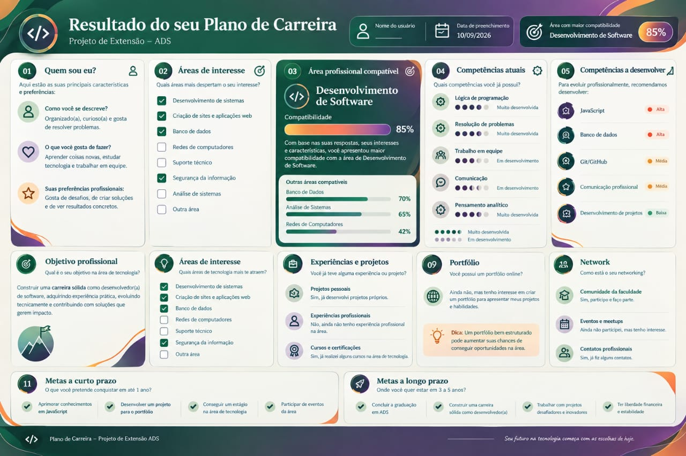
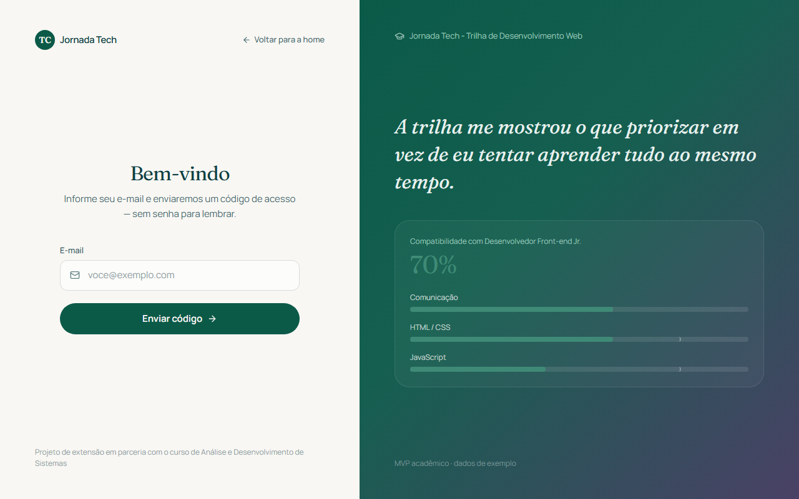

# Jornada Tech

Plano de carreira para estudantes de tecnologia, desenvolvido como projeto de extensão.
O aluno percorre uma jornada guiada para mapear interesses, escolher um perfil profissional,
avaliar suas competências e definir metas. No fim, recebe um **Canvas de Carreira** e um
**plano de ação** salvos no painel. O Canvas pode ser impresso em uma página A4 paisagem.

Cursos atendidos: **Análise e Desenvolvimento de Sistemas** (ADS, 5 semestres),
**Sistemas de Informação** (SI, 8 semestres) e **Ciência da Computação** (CC, 8 semestres).

<p align="center">
  
  <br>
  <sub>Modelo de referência do Canvas de Carreira, que orientou o visual do painel. Os dados são ilustrativos.</sub>
</p>

## Como funciona

1. **Quem sou eu** (`/self`): curso, semestre, interesses e contexto.
2. **Área de interesse** (`/field-interest`): escolha de **um** perfil profissional-alvo entre
   as 8 carreiras do curso do aluno.
3. **Autoavaliação** (`/self-evaluation`): nota de 0 a 5 em cada competência do perfil
   (7 técnicas e 4 comportamentais), com a descrição de cada nível na tela.
4. **Canvas** (`/canvas`): Canvas de Carreira, com as competências a desenvolver já sugeridas.
5. **Plano de ação** (`/action-plan`): metas de curto e médio prazo (objetivo, ação, prazo e
   indicador). Para concluir a jornada, o aluno responde a um questionário curto de feedback.
6. **Painel** (`/dashboard`): Canvas de Carreira com os 10 blocos do projeto, metas marcáveis
   e análise de lacunas.

No primeiro acesso, o aluno segue as etapas em ordem. Depois de concluir, o login leva direto
ao painel, e qualquer etapa pode ser editada. Se o aluno trocar de curso e a carreira escolhida
não pertencer ao novo curso, ele volta para a escolha de perfil.

A partir das notas da autoavaliação, o sistema calcula a **compatibilidade** do aluno com o
perfil escolhido e uma **trilha** com as 5 competências mais urgentes, cada uma com um tipo de
recomendação (curso estruturado, projeto prático ou prática dirigida). As regras do algoritmo
estão em [`CLAUDE.md`](CLAUDE.md), na seção "Algoritmo de análise de lacunas".

### Telas

| Página inicial | Login por código |
|---|---|
|  |  |

<p align="center">
  
  <br>
  <sub>Página inicial no celular.</sub>
</p>

O catálogo de carreiras e competências fica em
[`docs/carreiras_tecnologia.json`](docs/carreiras_tecnologia.json) (fontes: CBO, SBC, DCN,
O\*NET e ESCO). Ele é lido só no servidor.

## Stack

- [Next.js 16](https://nextjs.org) (App Router) + React 19 + TypeScript
- [Prisma 7](https://www.prisma.io) com Postgres no [Supabase](https://supabase.com)
- Supabase Auth: login sem senha, com código enviado por email
- Zod, Tailwind CSS 4 e `lucide-react`
- Vitest (testes unitários) e Playwright (E2E)

O backend é o próprio Next.js, por meio de Server Actions; não há servidor separado nem
acesso ao Supabase pelo navegador.

## Como rodar localmente

Pré-requisitos: Node.js 20.9 ou superior, npm e um projeto no Supabase.

```bash
npm install                # também gera o Prisma Client (postinstall)
cp .env.example .env       # preencha as variáveis (veja abaixo)
npx prisma migrate deploy  # aplica as migrations no banco
npm run dev
```

O app fica em [http://localhost:3000](http://localhost:3000).

### Variáveis de ambiente

Todas estão descritas em [`.env.example`](.env.example):

| Variável | Obrigatória | Uso |
|---|---|---|
| `DATABASE_URL` | Sim | Pooler do Supabase (transaction mode, porta 6543), usado pela aplicação. |
| `DIRECT_URL` | Para migrations | Conexão direta ou session pooler (porta 5432), usada só pelo Prisma Migrate. |
| `NEXT_PUBLIC_SUPABASE_URL` | Sim | URL do projeto (Project Settings → API). |
| `NEXT_PUBLIC_SUPABASE_ANON_KEY` | Sim | Chave anon do projeto (Project Settings → API). |
| `SMTP_*` | Não | Email do código do sorteio. O sorteio está desativado. |

Nunca faça commit do arquivo `.env`.

### Configuração do Supabase

- **Template de email:** em Authentication → Emails → Templates, os templates **Magic Link**
  e **Confirm signup** devem usar `{{ .Token }}` (código de 6 dígitos) como texto visível,
  e não o link mágico. O assunto e o HTML estão em
  [`docs/template-email-otp.md`](docs/template-email-otp.md).
- **SMTP próprio:** o SMTP embutido do Supabase tem limite baixo de envios. Em produção,
  configure um SMTP próprio em Authentication → Emails → SMTP Settings.

## Deploy (Vercel)

O app é um projeto Next.js comum e pode ser publicado na [Vercel](https://vercel.com) sem
configuração extra (não há `vercel.json`, e `next.config.ts` não precisa de ajustes).

1. **Conferir a branch** antes de publicar:
   ```bash
   npm run lint
   npx tsc --noEmit
   npm test
   npm run build
   ```
2. **Aplicar as migrations no banco de produção**, a partir da máquina local, com o `.env`
   apontando para o banco de produção:
   ```bash
   npx prisma migrate deploy
   ```
   O comando usa `DIRECT_URL` (porta 5432); pela conexão pooled (6543) ele trava. Faça isso
   antes de publicar uma versão que dependa de uma migration nova.
3. **Criar o projeto na Vercel**, importando o repositório do GitHub. Framework: Next.js;
   comando de build e instalação padrão (`npm install` roda o `prisma generate`).
4. **Cadastrar as variáveis** em Settings → Environment Variables (Production e Preview):
   `DATABASE_URL`, `NEXT_PUBLIC_SUPABASE_URL` e `NEXT_PUBLIC_SUPABASE_ANON_KEY`.
   `DIRECT_URL` não é necessária no build. As variáveis `NEXT_PUBLIC_*` entram no build:
   ao alterá-las, faça um novo deploy.
5. **Configurar o Supabase para produção:**
   - Authentication → URL Configuration: em **Site URL**, o domínio de produção.
   - Template de email com `{{ .Token }}` e SMTP próprio (ver acima).
6. **Testar em produção:** pedir o código, entrar, percorrer a jornada até o painel e
   imprimir o Canvas.

Cada push na `main` gera um novo deploy de produção; as outras branches geram previews, que
usam o mesmo banco se as variáveis de Preview apontarem para ele.

## Comandos

| Comando | O que faz |
|---|---|
| `npm run dev` | Servidor de desenvolvimento |
| `npm run build` / `npm start` | Build e servidor de produção |
| `npm run lint` | ESLint |
| `npx tsc --noEmit` | Checagem de tipos |
| `npm test` | Testes unitários (Vitest) |
| `npm run test:e2e` | Testes E2E (Playwright; sobe o dev server na porta 3100) |
| `npx prisma migrate dev --name <nome>` | Cria uma nova migration |
| `npx prisma migrate deploy` | Aplica as migrations pendentes |

Uma mudança só está pronta quando lint, checagem de tipos e testes passam e as migrations
aplicam sem erro. Os testes E2E cobrem só as rotas públicas, os redirecionamentos e a
validação do login.

## Banco de dados

Toda mudança de esquema é feita em [`prisma/schema.prisma`](prisma/schema.prisma) e gera uma
migration; o banco nunca é alterado manualmente (não use `prisma db push`). Todas as tabelas
têm RLS habilitado sem policies, para bloquear a Data API do Supabase: o acesso aos dados passa
sempre pelo servidor, filtrado pelo usuário logado.

O banco guarda só o que o aluno informa (perfil, notas, Canvas, metas e feedback).
Compatibilidade e trilha são recalculadas na leitura.

## Sorteio do Evento Conexão (desativado)

O sorteio foi realizado em 26/10/2026 e saiu das telas. O código de backend
(`lib/raffle.ts`, `lib/raffle-entry.ts`, `lib/email.ts`) e a tabela `RaffleEntry` foram
mantidos, sem uso. Os passos para reativar estão em [`CLAUDE.md`](CLAUDE.md), na seção
"Sorteio (desativado)".

## Estrutura

```
app/
  (journey)/        etapas 1 a 5 da jornada (page + form + Server Action)
  dashboard/        painel com o Canvas de Carreira
  login/            login por código enviado por email
  _landing-antiga/  landing anterior, fora do roteamento
components/         cabeçalho, rodapé das etapas e resumo de lacunas
lib/
  career/           catálogo, cursos, escala, algoritmo de lacunas e sugestões
  validation/       schemas Zod de cada etapa
  supabase/         client do Supabase por requisição
  auth.ts           requireUser() e requireStep()
  journey.ts        regras de navegação da jornada
  prisma.ts         singleton do Prisma Client
prisma/             schema e migrations
e2e/                testes Playwright
docs/               documentação do projeto
proxy.ts            renovação da sessão e redirecionamentos
```

## Documentação

A pasta [`docs/`](docs) reúne a documentação do projeto (não use `public/` para isso: tudo ali
é servido publicamente):

- [Conceito do MVP](docs/Conceito%20do%20MVP%201.0.pdf)
- [Portfólio institucional](docs/Portf%C3%B3lio%20Institucional%20do%20Projeto%20Jornada%20Tech%202.pdf)
- [Catálogo de carreiras e competências](docs/carreiras_tecnologia.json) e a
  [curadoria anterior](docs/curadoria-competencias.pdf) (6 perfis, só ADS)
- [Documentação do Canvas de Carreira](docs/documentacao-canvas-carreira.pdf) e
  [modelo do Canvas](docs/modelo-do-canvas.jpeg)
- [Identidade visual](docs/identidade_visual_plano_de_carreira_ads.md)
- [Template do email de código de acesso](docs/template-email-otp.md)
- [Dados disponíveis por setor](docs/dados-disponiveis-por-setor.pdf): o que o banco permite
  extrair para a coordenação do curso, a direção da instituição e o núcleo de extensão
- [Pôster do sorteio do Evento Conexão](docs/poster-sorteio-evento-conexao.pdf) (histórico)
- [Projeto integrador de Fundamentos em Análise e Projeto de Sistemas](docs/projeto-integrador/Projeto-Integrador-Jornada-Tech.pdf)
  e o [deck da apresentação](docs/projeto-integrador/Jornada-Tech-Apresentacao.pptx)

As regras de negócio, convenções de código e decisões de arquitetura estão em
[`CLAUDE.md`](CLAUDE.md).
